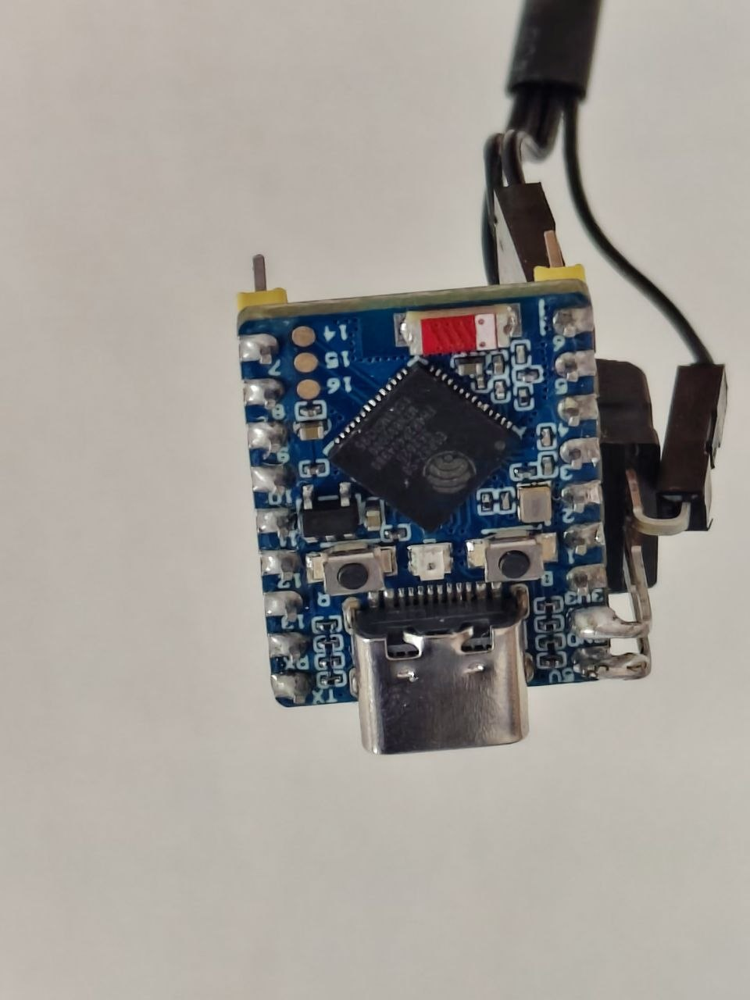
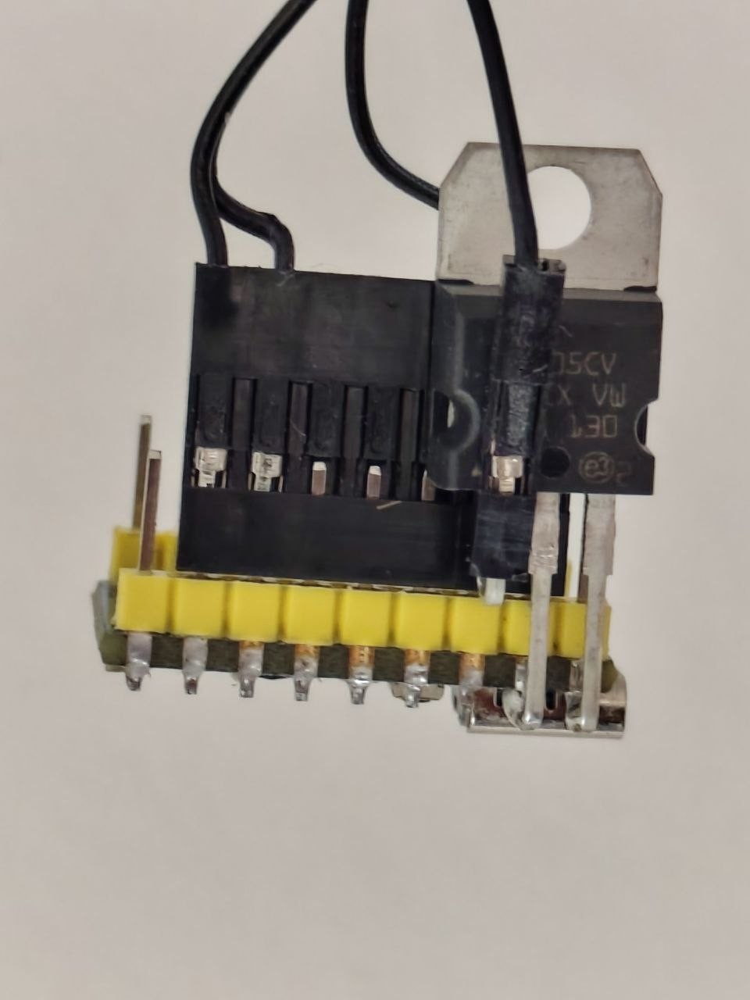
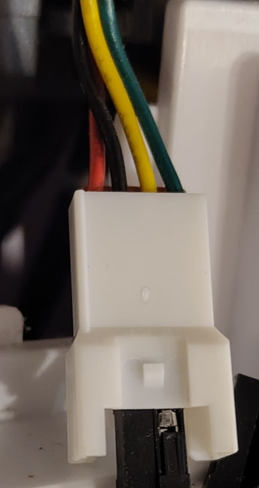

# Airton climate for ESPHome

ESPHome climate platform that replaces the Wi-Fi module of an Airton air conditioner. The ESP
takes the role of the original module (address `0x21`) on the serial link to the climate board.

This repository distributes the ESPHome component and an independent English datasheet for the
Airton serial protocol. The datasheet is available in [`docs/`](docs/airton-protocole.pdf).

ESPHome upstream now ships this component as `airton_serial`, because ESPHome already has an
IR-based `airton` component. This repository keeps `airton` for the existing installation.

The local `airton` component targets ESPHome **2026.10 and later**. The upstream `airton_serial`
component targets ESPHome **2026.11 and later** and uses its newer sub-entity helpers.

## What it does

- sends the display announcement `A5` every 10 s (keeps the display/heartbeat alive);
- polls the climate board with `AB` every 60 s;
- parses the `A3`/`A6` state frames and the `AC` poll response;
- sends `A1` commands after the first `A3` when Home Assistant changes mode, target temperature,
  fan speed or swing;
- exposes a standard ESPHome `climate` entity, optional switches and sensors.

No cloud, no Tuya, no Wi-Fi module.

## Scope

- HVAC modes: `off`, `heat_cool`, `cool`, `heat`, `dry`, `fan_only`;
- target temperature 16–31 °C, current temperature from `A3[10]` + `A3[11]`/10 (0.1 °C);
- fan speeds: `auto`, `low`, `medium`, `high`, `quiet`, plus custom `medlow`, `medhigh`, `strong`;
- swing: `off`, `vertical`, `horizontal` and `both` (protocol bitmask); positions 1–5 are not exposed;
- switches: `display`, `ionizer`, `health` (shared anti-mould/auxiliary heat bit), `sleep`, `eco`;
- sensors: total usage time (hours, from `AC`) and protocol revision (diagnostic);
- `A1` flags are preserved; cooling uses flags `0x80`, not `0x90`;
- commands are only sent after the first `A3`; before that, changes are ignored.

## Power

The module connector provides +12 V. Never connect it directly to the ESP. Use any **5 V
regulator** that can supply the ESP current:

| Regulator   | Connection                            |
| ----------- | ------------------------------------- |
| VIN+        | +12 V (red) from the module connector |
| VIN−        | common GND                            |
| VOUT+ (5 V) | ESP 5V / VIN pin                      |
| VOUT−       | ESP GND                               |

A classic **7805** works; the one in the photos is used bare and stays barely warm. A
12 V → 5 V buck module also works and is more efficient. Verify the output is 5.0 V with a
multimeter **before** connecting the ESP. Add a 0.5–1 A fuse in the 12 V line, and observe
polarity. Do not connect the regulator's 5 V output and USB power at the same time. Add
input/output capacitors if the module does not include them.

<p>
  
  
</p>

_Example: bare 7805 regulator. A 12 V → 5 V buck module also works. Here on a ESP32-S3-zero board_

## Wiring

| Connector   | Connection                                             |
| ----------- | ------------------------------------------------------ |
| +12 V (red) | 12 V input of the converter; never directly to the ESP |
| TX (black)  | GPIO5 (ESP TX)                                         |
| RX (yellow) | GPIO4 (ESP RX)                                         |
| GND (green) | common GND (converter, ESP, climate)                   |

Common ground is mandatory. The original Wi-Fi module must be unplugged before the ESP transmits
on the bus. The link is TTL 5 V; use an interface compatible with your MCU.



_Connector on the unit used for this component. Wire colors are unit-specific; verify them with a
multimeter before connecting._

## Installation

Add the external component to your YAML:

```yaml
external_components:
  - source:
      type: git
      url: https://github.com/guiguid/airton-esphome
      ref: main
      path: components
    components: [airton]

uart:
  - id: airton_bus
    baud_rate: 9600
    tx_pin: GPIO5
    rx_pin:
      number: GPIO4
      mode:
        input: true
        pullup: true

climate:
  - platform: airton
    id: airton_climate
    name: "Airton Climate"
    uart_id: airton_bus

switch:
  - platform: airton
    airton_id: airton_climate
    display:
      name: Display
    ionizer:
      name: Ionizer
    health:
      name: Health
    sleep:
      name: Sleep
    eco:
      name: Eco

sensor:
  - platform: airton
    airton_id: airton_climate
    total_usage_time:
      name: Total usage time
    revision:
      name: Protocol revision
```

`airton` requires `uart` and `climate`; the UART must be 9600 8N1 with both TX and RX.

## Protocol documentation

- [Protocol specification (Markdown, English)](docs/airton-protocole.md)
- [Protocol datasheet (PDF, English)](docs/airton-protocole.pdf)

## Notes

- The `A5` announcement uses the ESP's own MAC address; no fixed MAC is stored.
- Keepalives start at boot, so the climate board/display see a module present from the start.
- The component is tested on an ESP32-S3-Zero with an Airton unit, module unplugged.

## License

MIT — see `LICENSE`.
